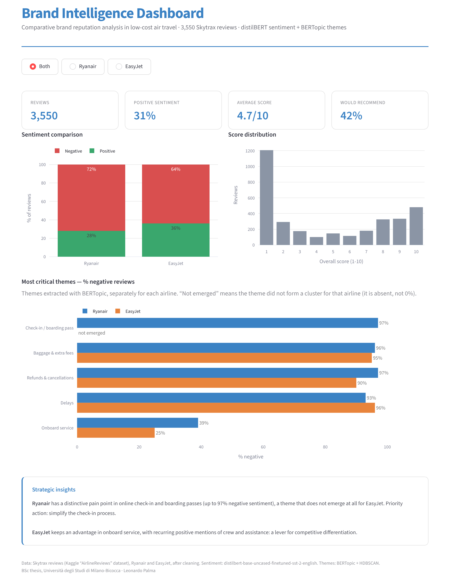
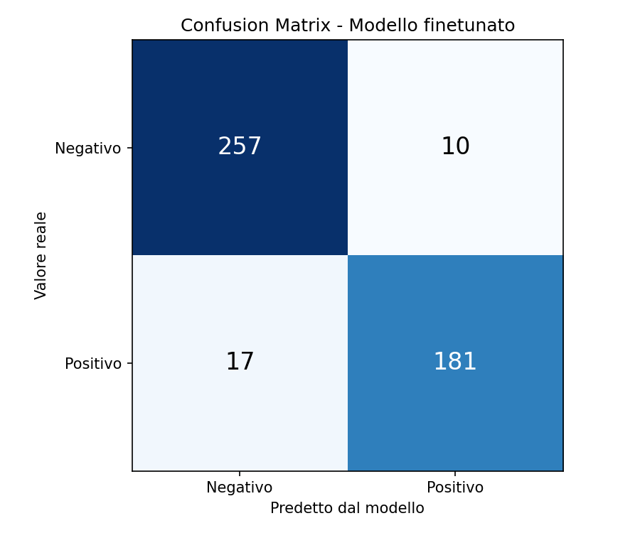
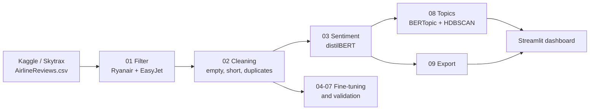

# Airline Brand Intelligence — Ryanair vs EasyJet

An NLP pipeline that turns 3,550 customer reviews into a comparative brand reputation analysis of Europe's two largest low-cost airlines. It combines **transformer-based sentiment analysis**, **topic modeling** and an **interactive dashboard**.

Built for my BSc thesis in Economics, Global Markets and Corporate Communication at Università degli Studi di Milano-Bicocca (2026).



## Key findings

- **Ryanair's viral marketing does not translate into a better reputation.** Only 28% of Ryanair reviews are positive, compared with 36% for EasyJet. Average scores are 4.4/10 and 5.1/10.
- **Check-in and boarding passes are Ryanair's distinctive pain point**, with up to 97% negative reviews. The theme does not emerge as a cluster for EasyJet at all.
- **Baggage fees, refunds and delays** are shared pain points (90–97% negative for both airlines).
- **Onboard service is EasyJet's relative strength**: 25% negative reviews, against 39% for Ryanair.

## Model performance

The pre-trained distilBERT (SST-2) was validated on the airline domain by fine-tuning it on reviews labelled from their Skytrax score (1–4 negative, 7–10 positive). The test set has 465 reviews, held out with a stratified 70/15/15 split.

| Model | Accuracy | F1 |
|---|---|---|
| distilBERT base (SST-2) | 87.5% | 0.831 |
| distilBERT fine-tuned (2 epochs) | **94.2%** | **0.931** |

The final model uses 2 epochs: a third epoch kept increasing validation loss for a marginal accuracy gain, a sign of overfitting.



## Pipeline



| Step | Script | Output |
|---|---|---|
| 1 | `src/01_prepara_dati.py` | Ryanair and EasyJet reviews only |
| 2 | `src/02_pulizia.py` | Cleaned corpus (3,550 reviews) |
| 3 | `src/03_sentiment_analysis.py` | Positive / negative label for each review |
| 4 | `src/04_prepara_finetuning.py` | Labelled train / validation / test sets |
| 5 | `src/05_finetuning_train.py` | Fine-tuned model in `models/` |
| 6 | `src/06_confronto_modelli.py` | Base vs fine-tuned comparison |
| 7 | `src/07_confusion_matrix.py` | `assets/confusion_matrix.png` |
| 8 | `src/08_temi_sentiment.py` | Themes per airline with % negative |
| 9 | `src/09_esporta_dashboard.py` | `data/dashboard_data.csv` |

Code comments are in Italian.

## Run it

**Dashboard only.** The data it needs is already in the repo.

```bash
pip install -r requirements.txt
streamlit run app/dashboard.py
```

**Full pipeline.** Download the dataset (see [`data/README.md`](data/README.md)), place it in `data/raw/`, then run:

```bash
cd src
python 01_prepara_dati.py
python 02_pulizia.py
# ... up to 09
```

Fine-tuning ran on an Apple M1 with MPS acceleration.

## Repository structure

```
├── app/dashboard.py     Streamlit dashboard
├── src/                 Pipeline, numbered in execution order
├── exploration/         Early experiments (scraping test, first topic runs)
├── data/
│   ├── dashboard_data.csv     Airline, score, recommendation and sentiment (no review text)
│   └── results/               Aggregated topic results
└── assets/              Images used in this README
```

## Limitations

- The whole corpus is classified with the **pre-trained** distilBERT model. The fine-tuned model was used to validate how reliable sentiment classification is on this domain.
- BERTopic is stochastic. The figures in the thesis come from a single run, so re-running step 8 can shift individual topic percentages by a few points. A fixed UMAP seed has since been added for reproducibility.
- Skytrax reviewers self-select and skew negative, so the results describe *relative* reputation between the two airlines, not absolute customer satisfaction.

## Stack

Python · pandas · Hugging Face Transformers (distilBERT) · BERTopic · HDBSCAN · UMAP · scikit-learn · Streamlit · Plotly · matplotlib

---

**Leonardo Palma** · BSc thesis, supervisor Prof. Lorenzo Malandri · Università degli Studi di Milano-Bicocca
